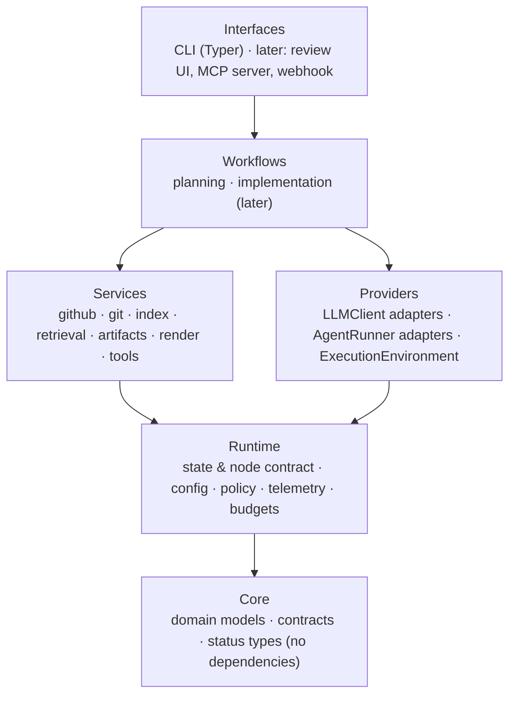

# Architecture

**Type:** Explanation · **Status:** Draft v1 · **Last updated:** 2026-10-08
**Diagram:** [`architecture.drawio`](../diagrams/architecture.drawio)

Code-OG (`code-on-graph`, command `cog`) is a standalone "command center" for AI-assisted software work. It runs workflows (Planning first, Implementation later) against many repos from one installation, with every step logged and every human decision point explicit.

---

## 1. What it is, and what it is not

**Is:** a Python application that orchestrates deterministic code and bounded LLM calls through LangGraph workflows; installed once; operates on managed clones of repos; keeps all state in a local data directory.

**Is not:**

- **A chat application.** Interaction is structured pauses (approve, edit, reject, answer), not a conversation. See [Interaction model](interaction-model.md).
- **A per-repo tool.** Nothing is installed into repos, and repos get no footprint unless you export ([ADR-0008](../decisions/0008-standalone-command-center-managed-clones.md)).
- **Opinionated about code style.** Repo conventions outrank harness preferences ([ADR-0014](../decisions/0014-repo-convention-precedence.md)).
- **Multi-user (yet).** Seams exist; features do not ([ADR-0013](../decisions/0013-scale-seams-not-scale-features.md)).

---

## 2. Layers

**Dependency rule:** arrows point downward only.

- Workflows depend on provider and service **interfaces**. They never import an adapter or a vendor SDK; dependencies are injected when the graph is built.
- Services and providers are peers. Neither imports workflows.
- Core imports nothing from the project.
- The rule is enforced in CI by an import-boundary checker. **(verify)** tool choice (for example, import-linter).

The hand-drawn version, including external systems and the data directory, is in [`architecture.drawio`](../diagrams/architecture.drawio).

---

## 3. The three places things live

| Place                                   | What lives there                                                               | Created                    |
| --------------------------------------- | ------------------------------------------------------------------------------ | -------------------------- |
| **cog's source repo** (`code-on-graph`) | Code and `docs/`                                                               | By you (roadmap step 0)    |
| **cog's data directory**                | Runs, checkpoints, plans, indexes, mirrors, managed clones                     | Automatically on first run |
| **Target repos**                        | Nothing, unless you run `cog plan export` or an Implementation step opens a PR | Only on request            |

See [Configuration and data](configuration-and-data.md) for the data directory layout.

---

## 4. Execution model

- **Async-first** ([ADR-0002](../decisions/0002-async-first.md)): nodes, services, and adapters are async. Blocking work goes through one thread-pool helper; subprocesses go through one wrapper that handles timeouts and process-tree kills.
- **Runs.** A run is one execution of one workflow on one input (for example, Planning on issue 123 of a repo). It has a `run_id`, which is also the LangGraph `thread_id`.
- **Status over exceptions.** Expected conditions (nothing found, validation failed, budget exceeded) are statuses returned by nodes. Only unexpected faults raise.
- **Bounded everything.** Loops have limits, LLM calls have token and cost budgets, subprocesses have timeouts.
- **Idempotent where possible.** Fetch and retrieval nodes can safely re-run, which makes caching, retries, and resume safe.
- **Concurrency.** Runs on different repos or issues may execute in parallel. Writes to shared state (SQLite) are serialized by WAL mode and short transactions; per-repo locks guard clone fetches and index builds. Starting a second run for the same issue warns and creates a distinct run id.

---

## 5. State and persistence in one paragraph

LangGraph checkpoints hold in-flight run state. An event store records what each node and call did. Plans are immutable JSON files with SQLite as an index, and large payloads live in a content-addressed blob store. Everything is local; nothing leaves the machine except calls to providers you configure and to GitHub. Details: [Configuration and data](configuration-and-data.md), [ADR-0006](../decisions/0006-local-first-storage-no-logging-service.md), [ADR-0007](../decisions/0007-plans-as-immutable-json.md).

---

## 6. Providers in one paragraph

Two interfaces: `LLMClient` (completions, structured output, bounded read-only tools) for Planning, and `AgentRunner` (executes a task in a worktree) for Implementation. Config maps tiers to adapters and models. Fireworks and OpenRouter come first through one OpenAI-compatible adapter. Agent CLIs and SDKs are optional runners. Details: [Providers](providers.md).

---

## 7. Platform support

| Tier | Platform                                         | Commitment                            |
| ---- | ------------------------------------------------ | ------------------------------------- |
| 1    | Windows (Git Bash, PowerShell, Windows Terminal) | Primary; tested in CI                 |
| 2    | Linux                                            | CI; WSL2 for Implementation execution |
| 3    | macOS                                            | Supported; best-effort CI             |

Planning is built and run natively on Windows. **Implementation execution moves to WSL2 or containers** because it runs agents that edit files and run commands, which need real containment. This decision, its reasons, the expected changes, and the triggers for revisiting it are recorded in [ADR-0011](../decisions/0011-platform-support-and-implementation-execution-environment.md).

### Windows rules the design follows

| Area           | Rule                                                                                                                                          |
| -------------- | --------------------------------------------------------------------------------------------------------------------------------------------- |
| Paths          | `pathlib` everywhere; stored paths are POSIX-style; Git Bash `/c/...` paths never accepted internally; deny-list compares case-folded paths   |
| Clone paths    | Short, hash-based names; `core.longpaths` set; no reliance on symlinks                                                                        |
| Line endings   | Read through git blobs so CRLF conversion cannot alter spans or hashes                                                                        |
| Subprocesses   | Argument lists, never shell strings; resolve wrapper scripts (`mvnw.cmd`, `gradlew.bat`, `npm.cmd`) explicitly; kill process trees on timeout |
| Runners        | Each records its `shell` (`bash` or `pwsh`); live contract tests run on your machine                                                          |
| Terminal       | Plain prompts and explicit `cog resume`; no dependence on a rich TUI, since Git Bash terminals commonly have quirks with interactive programs |
| Data directory | Resolved with `platformdirs`; must not be in a cloud-synced folder                                                                            |
| CI             | Windows and Linux matrix; macOS best-effort                                                                                                   |

### `ExecutionEnvironment`

All command execution goes through one interface so the Implementation move to WSL2 or containers does not touch workflows.

| Implementation | Used for                                     |
| -------------- | -------------------------------------------- |
| `LocalProcess` | Planning-side git and tooling; development   |
| `Wsl`          | Implementation on Windows (expected)         |
| `Container`    | Alternative isolation; future remote workers |

---

## 8. Cross-cutting concerns

| Concern                   | Where it lives                                      | Notes                                                                                                                                                                                                               |
| ------------------------- | --------------------------------------------------- | ------------------------------------------------------------------------------------------------------------------------------------------------------------------------------------------------------------------- |
| **Policy and sandboxing** | Runtime policy module + `ExecutionEnvironment`      | Path deny-list, command allow-list, environment scrubbing, secret redaction before provider calls. Enforced inside tool functions, not only in validators. Detailed in [Policy and sandbox](policy-and-sandbox.md). |
| **Budgets and cost**      | Runtime budgets + provider layer                    | Per-run and per-node token and dollar caps, cost estimate before long runs, kill switch. See [Providers](providers.md).                                                                                             |
| **Telemetry**             | Runtime telemetry                                   | Event store, structured logs, OpenTelemetry-shaped events.                                                                                                                                                          |
| **Prompts**               | Per-workflow prompt files                           | Versioned, recorded in run records, per-model overrides. See [Providers](providers.md).                                                                                                                             |
| **Convention neutrality** | `repo_conventions` node, prompts, acceptance checks | See [ADR-0014](../decisions/0014-repo-convention-precedence.md).                                                                                                                                                    |
| **Data egress**           | Policy module                                       | Which repos may go to which provider; secrets redacted from context packs.                                                                                                                                          |

---

## 9. Scale seams

Interfaces with local implementations now; scale implementations later. See [ADR-0013](../decisions/0013-scale-seams-not-scale-features.md).

| Seam                                              | Now                     | Later                              |
| ------------------------------------------------- | ----------------------- | ---------------------------------- |
| Stores (`PlanStore`, `ArtifactStore`, `RunStore`) | Files + SQLite          | Object storage + Postgres          |
| VCS access                                        | Token / `gh auth token` | GitHub App                         |
| Execution                                         | Local, WSL2             | Containers, remote workers         |
| Interfaces                                        | CLI                     | Web review UI, MCP server, webhook |

---

## 10. Related documents

- [Repo layout](../reference/repo-layout.md): the planned source and docs trees.
- [LangGraph primer](langgraph-primer.md)
- [Providers](providers.md)
- [Interaction model](interaction-model.md)
- [Configuration and data](configuration-and-data.md)
- [Indexing](indexing.md) · [Policy and sandbox](policy-and-sandbox.md) · [Testing and evaluation](testing-and-evaluation.md) · [Documentation strategy](documentation-strategy.md)
- [Implementation outline](../workflows/implementation/outline.md)
- [ADR index](../decisions/README.md)
