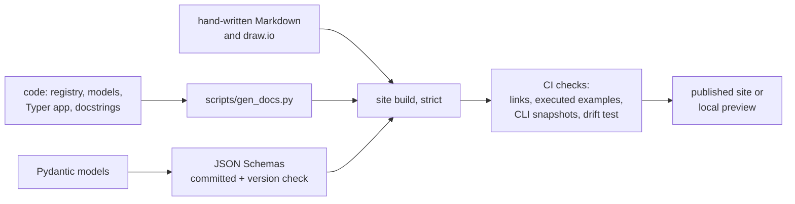

# Documentation Strategy

**Type:** Explanation · **Status:** Draft v1 · **Last updated:** 2026-10-06
**Decision:** [ADR-0010](../decisions/0010-documentation-strategy-and-tooling.md)
Tool facts were checked in Round 1 (2026-10-06). Items marked **(verify)** are tracked in the [roadmap's verification log](../roadmap.md#verification-log).

---

## 1. Goals

1. **Cover both technical and product documentation:** how the system works, and how to use it.
2. **Automate whatever can be derived** so it cannot drift.
3. **Serve three readers:** you now, collaborators later, and coding agents that build from the docs as a specification.
4. **Keep one source of truth per concept.** Link; do not copy.

---

## 2. Structure: Diátaxis

Diátaxis sorts documents into four types by what the reader needs. It is a way to organize files, not a storage system; everything is Markdown (plus draw.io) in the repo.

| Type | Reader's need | Where | Mostly |
|---|---|---|---|
| **Tutorials** | Learn by doing | `docs/tutorials/` | Hand-written, with generated example output |
| **How-to guides** | Complete a task | `docs/how-to/` | Hand-written, tested |
| **Reference** | Look something up | `docs/reference/`, workflow references | **Generated** where possible |
| **Explanation** | Understand why | `docs/explanation/`, `docs/decisions/` | Hand-written |

Product and usage documentation is how-to and tutorial content; feature descriptions are explanation. Tutorials and how-to pages start when the CLI exists.

---

## 3. What is generated and what is written

| Content | Source of truth | Generator | Committed? |
|---|---|---|---|
| Node reference tables | Node registry and templated node docstrings | `scripts/gen_docs.py` | No (built into the site) |
| Graph diagrams (Mermaid) | Compiled LangGraph graph | `get_graph()` Mermaid export | No |
| **Diagram drift check** | Registry vs generated graph vs draw.io node names | A test | n/a |
| Config reference | The settings models (names, types, defaults, env vars) | Generator | No |
| CLI reference | The Typer app | Typer docs tooling or `--help` snapshots **(verify)** | No (snapshots committed as tests) |
| **Contract JSON Schemas** (`Plan`, `Task`, ...) | Pydantic models | Schema export | **Yes**, with a check that a change requires a `schema_version` bump |
| API reference | Docstrings | A docstring renderer, chosen by the site-tool spike | No |
| ADR index table | ADR files | Generator (optional) | The index file stays committed |
| Changelog | Conventional commits | A changelog tool **(verify choice)** | Yes |
| Usage examples and terminal output | Real runs against fixture repos with `FakeLLM` | Executed docs | Output regenerated in CI |
| Concepts, rationale, ADRs, workflow design | Human | n/a | Yes |

The generation script emits **plain Markdown**, so the site generator is swappable ([ADR-0010](../decisions/0010-documentation-strategy-and-tooling.md)).

---

## 4. Hand-written pages

- **Header:** every page opens with Type, Status, and Last updated.
- **Status values:** Draft, Reviewed, Stable, Superseded.
- **American English.**
- **One concept, one page.** Reference documents link to explanations rather than repeating them. Shared tables (for example, platform tiers) live in one place.
- **`(verify)` markers** flag claims that depend on external behavior. Each is tracked in the roadmap's verification log, which records the evidence and date when an item is settled, after which the marker is removed from the page.
- **ADRs are immutable.** Changes are new ADRs or dated addenda. Never rewrite history.
- **Docs are a build specification for agents:** stable node ids, contracts in code blocks, a status marker per node taken from the registry, and `AGENTS.md` at the root.
- **Illustrative snippets** are labeled illustrative so nobody mistakes them for project code.

### Diagrams

- **draw.io** for large, spatial, color-coded diagrams, one file each, saved as **uncompressed XML** so diffs are readable.
- **Mermaid** inline for small teaching diagrams that belong beside their text.
- Colors for workflow diagrams: green deterministic, orange LLM, blue human, yellow decision, gray start/end/persisted.
- Large diagrams may be exported to SVG for the site by a CI step if a draw.io command-line export is practical on all platforms **(verify)**; until then they are linked as files.
- The drift test compares draw.io node ids and names against the registry.

---

## 5. Site tool

Criteria: Markdown and Mermaid support, search, a strict mode that fails on broken links, a path to API reference from Python docstrings, a Windows-friendly build, speed, and low maintenance risk.

| Candidate | Status (as researched in Round 1) | Role |
|---|---|---|
| **Zensical** | From the team behind Material for MkDocs; pre-1.0; installs with `uv`; supports Mermaid; docstring-based API reference through mkdocstrings is preliminary | **Try first** |
| **Material for MkDocs + mkdocstrings** | Material is in maintenance mode, with fixes planned for a limited period; mkdocstrings maintained at least through the end of 2026 | Fallback; pinned versions |
| **Sphinx + MyST** | Mature; strongest Python autodoc | Fallback if the API reference story fails |
| Docusaurus | Capable, but adds a Node toolchain and has no native Python API docs | Not chosen |

**Spike (Phase 1, about an hour):** build a stub site containing one Markdown page, one Mermaid diagram, one generated table, and one API-reference page; run it on Windows and Linux; run a strict build with a deliberate broken link. Pass if all of that works. The result is recorded as an ADR, and because generators emit plain Markdown, switching tools later costs little.

---

## 6. Quality gates in CI

- Strict site build (broken links and missing pages fail).
- Link checking, internal always and external optionally.
- Executed examples: code blocks and CLI transcripts in how-to pages run against fixture repos, so usage docs cannot rot. Tool choice **(verify)**.
- CLI help snapshots and contract-schema diff check ([Testing and evaluation](testing-and-evaluation.md)).
- Drift test (registry, graph, draw.io).
- Optional spell and style checks; an American English check is possible **(verify tools)**.
- A pull-request checklist item: "Docs updated, or not needed because ___."

---

## 7. Product and usage documentation (once the CLI exists)

Planned how-to guides: add a repo; plan an issue; review and approve a plan; answer a clarifying question and resume; configure Fireworks and OpenRouter; export a plan into a repo; read the run history and costs; diagnose problems with `cog doctor`; add a provider adapter; add a retriever; add a language to the index.

Planned tutorial: **"Your first plan, end to end,"** run against a fixture repo with a fake model so the output shown is always real and regenerated.

Rule: **terminal output in usage docs is captured, not typed.** A script runs the commands and inserts the transcript, so documentation matches behavior by construction.

---

## 8. Versioning and ownership

- Docs live on the main branch and change with the code. A pull request that changes behavior updates the matching pages.
- Releases tag the docs. Per-version documentation sites can be added when releases exist **(verify tooling then)**.
- The owner reviews documentation rounds now; later, CODEOWNERS for `docs/` can enforce review.
- After the three rounds, the node registry's `status` field and the roadmap are the live indicators of what is specified, stubbed, implemented, or tested.

---

## 9. Open questions

- Which site tool passes the spike.
- How terminal transcripts are captured and normalized across Windows and Linux (line endings, paths).
- Whether to publish a hosted site (for example, GitHub Pages) or keep it local for now.
- Changelog tool and commit-message convention, which must respect ADR-0014: the *harness's own* repo may choose a convention, but it must not impose one on target repos.
