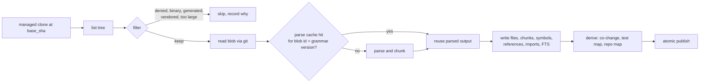

# Indexing

**Type:** Explanation · **Status:** Draft v1 · **Last updated:** 2026-10-06
**Used by:** Planning nodes 5, 6, 9, 10, 11, 16b, 18 · **Decision:** [ADR-0017](../decisions/0017-index-design.md)

Facts about third-party packages were checked on 2026-10-06. Items marked **(verify)** are tracked in the [roadmap's verification log](../roadmap.md#verification-log).

---

## 1. Why indexing exists

The planner cannot read a whole repo. Before it is called, the harness must decide which files, symbols, and documents to show it. To decide well, cog needs fast answers to questions like:

- Where is `X` defined, and who uses it?
- Which code mentions "invoice total" or this exact error string?
- What imports this file, and what tests cover it?
- Which files historically change together with this one?
- What does the repo look like at a glance?

Building the data structures that answer those questions is **indexing**. It is the largest subsystem in Planning because it sets a ceiling: if the right file never reaches the packed context, nothing downstream can fix it. That is why the first evaluation measures **context recall** before anything is tuned ([Testing and evaluation](testing-and-evaluation.md)).

---

## 2. What gets built

| Component                   | Answers                                   | Built from                            | Notes                                                                     |
| --------------------------- | ----------------------------------------- | ------------------------------------- | ------------------------------------------------------------------------- |
| **File inventory**          | What exists at this commit                | `git ls-tree` at `base_sha`           | Filtered by policy, size, and type (Section 5)                            |
| **Lexical index**           | Text and identifier search, error strings | SQLite FTS5 over chunks               | Identifier splitting at index time; optional trigram table for substrings |
| **Symbol index**            | Definitions, signatures, containment      | tree-sitter parse trees               | Java, TypeScript, Python first                                            |
| **Reference table**         | Where a name is used                      | Identifier occurrences in parse trees | **Name-based, not resolved**; see Section 6                               |
| **Import graph**            | What depends on what                      | Import statements per language        | File-level edges, best-effort module resolution                           |
| **Test map**                | Tests for a source file                   | Naming patterns plus imports          | Patterns are configurable; see Section 8                                  |
| **Co-change table**         | Files that change in the same commits     | `git log --name-only` over a window   | Cheap and strongly predictive                                             |
| **Repo map**                | Orientation within a token budget         | Ranked signatures                     | Aider-style; ranking over the import and reference graph                  |
| **Embeddings** _(optional)_ | Semantic similarity                       | Embedding model over chunks           | Deferred until the recall eval shows a gap                                |

---

## 3. The `Index` interface

Retrievers and the validator use one interface and never touch the storage directly. Signatures are illustrative.

```text
search_text(query, kinds, limit)        -> list of ranked chunks
find_symbol(name, kind=None)            -> definitions (path, range, signature)
references_to(name, limit)              -> occurrences (name-based, with confidence)
importers_of(path) / imports_of(path)   -> file paths
tests_for(path)                         -> file paths (with the rule that matched)
cochanged_with(path, limit)             -> (path, score)
exists(path)                            -> bool, and rename lookup
repo_map(token_budget)                  -> text
stats()                                 -> counts, build time, coverage by language
```

A language server or an embedding table can later be added behind the same interface without changing retrievers.

---

## 4. Keys, storage, and reading from git

- **Keyed by repo and commit.** One index per `(repo, base_sha)`, stored at `indexes/<repo>/<base_sha>/` in the data directory.
- **Reads come from git objects,** not a working tree: `git ls-tree` for the file list and `git cat-file --batch` for contents. Nothing depends on what is checked out, and CRLF conversion can never alter a span or a hash.
- **Atomic publish.** A build writes to a temporary database and renames it into place. A per-repo lock stops two runs from building the same commit twice; the second waits and shares the result.
- **SQLite** holds files, chunks, symbols, references, imports, co-change pairs, and the FTS tables. FTS5 availability in Python's bundled SQLite must be confirmed on every platform tier **(verify)**.
- Index files are a rebuildable cache. `cog gc` prunes them.

---

## 5. The build pipeline



### Filtering

Files are skipped, and the reason is recorded in the build report, when they are:

- **Denied by policy** ([Policy and sandbox](policy-and-sandbox.md)): `.env*`, key files, and similar. Secret-bearing files **never enter the index**, so they can never be retrieved or sent.
- **Binary**, **minified**, **generated** (by header marker or path convention), **vendored** (`node_modules`, `vendor`, build output), or over a size limit.
- Lockfiles are indexed only as file names, not content.

Filter rules are defaults that repo config may extend. They are not style opinions.

### The parse cache

Parsing is the expensive step. Parsed output is cached **by git blob id plus grammar version**. A new commit only re-parses blobs that changed, so even a "full rebuild" is incremental in practice, and two commits share almost all the work. This keeps v1 simple (always rebuild from the tree) while scaling to large repos. Cache entries are pruned by `cog gc` and invalidated when a grammar package changes.

### Chunking

- **Code:** one chunk per symbol (function, method, class header) with its signature and doc comment; large symbols are split on blank-line boundaries with a size cap. Files with no parseable symbols get fixed-size line windows.
- **Docs and Markdown:** one chunk per heading section, with the heading path stored as metadata (so the packer can show "Guide > Auth > Tokens").
- Every chunk stores `path`, line range, symbol (if any), kind, and a content hash.

### Identifier splitting

Issue text and code rarely use the same tokens: an issue says "invoice total" and the code says `calcInvoiceTotal` or `invoice_total`. Each chunk is indexed twice, in its original form and with identifiers split at case changes, underscores, dots, and digits, so both queries match. The splitting function is pure and property-tested.

### Exact and substring search

Error strings need exact matches, which a word-oriented FTS index handles poorly. v1 options, to be settled by the recall eval:

1. An FTS5 table with the trigram tokenizer for substring matching (requires a recent SQLite) **(verify)**.
2. A bounded literal scan over chunk text.
3. ripgrep over an exported temporary tree. This adds a tool and a materialization step because reads come from git objects, so it is included only if (1) and (2) measurably miss **(verify)**.

---

## 6. Languages

Java, TypeScript, and Python come first, through tree-sitter grammars behind the `Index` interface. The repos are backend, front end, and test automation, of varying size. What is extracted:

| Language                        | Symbols                                                                                   | Imports                                                           | Notes                                                                               |
| ------------------------------- | ----------------------------------------------------------------------------------------- | ----------------------------------------------------------------- | ----------------------------------------------------------------------------------- |
| **Java**                        | packages, classes, interfaces, enums, records, methods, constructors, fields, annotations | `import` statements, package structure                            | Maven and Gradle layouts are recognized for test roots, but no framework is assumed |
| **TypeScript** (and JavaScript) | modules, classes, interfaces, type aliases, functions, arrow-function constants, exports  | `import`/`export from`, path aliases from `tsconfig` when present | React components are just functions; no framework conventions are imposed           |
| **Python**                      | modules, classes, functions, methods, decorators                                          | `import`, `from ... import`                                       | Relative imports resolved against package layout                                    |

### Honest limits of tree-sitter

Tree-sitter gives accurate **syntax**, not **semantics**. References are matched by name, so two unrelated functions called `save` look identical, and overloads, inheritance, and dynamic dispatch are not resolved. cog treats references as **candidates with a confidence level** (exact qualified match > same-package match > bare name match), never as proof. Where accuracy matters, a language server (for example, for Java) could be added behind the same interface later.

### Packaging

- **`tree-sitter-language-pack`** is a maintained fork of the older `tree-sitter-languages`, bundles many grammars (including Java, Python, and TypeScript) as prebuilt wheels, and works with tree-sitter 0.22 and newer. Its newer releases advertise on-demand parser downloads, which would add a network dependency and a reproducibility concern **(verify)**.
- **The core `tree-sitter` package plus individually pinned grammar packages** (for example, a Java grammar package) gives explicit, reproducible versions at the cost of more dependencies.
- Prebuilt Windows wheels must exist for the chosen packages and Python versions **(verify)**.
- **Decision:** a Phase 3 spike compares the two, and the winner is recorded in an ADR amendment. Whichever is chosen, grammar versions are pinned in `uv.lock` and are part of the parse-cache key.

---

## 7. Derived data

### Co-change

Computed from `git log --name-only` over a recent window and stored as a pair-count table. Rules to keep it honest: ignore merge commits and bulk commits touching more than N files, follow renames, weight recent history more, and require a minimum co-occurrence. It is cheap, deterministic, and a strong predictor of "also touched," which is why it feeds the `neighbor` tier.

### Test map

For a source file, find its likely tests by:

1. **Naming and layout patterns per ecosystem.** Defaults: Java `FooTest`/`FooTests` mirrored under `src/test/java`; TypeScript `*.test.ts`, `*.spec.ts`, `__tests__/`; Python `test_*.py` and `*_test.py` under `tests/`.
2. **Imports:** test files that import the source module.

The patterns are defaults, discovered and overridable per repo ([ADR-0014](../decisions/0014-repo-convention-precedence.md)). The rule that matched is recorded, so a reviewer can see why a test was suggested.

### Repo map

A compact, ranked list of important files and signatures, sized to a token budget, for orientation. Ranking runs over the import and reference graph (as in Aider's approach), boosted by files named in the issue. It is always included in packed context, trimmed to its share of the budget.

### Embeddings (deferred)

Not built in v1. The decision rule from Planning is to add them only if the recall eval shows a gap lexical and structural search cannot close. If added: chunk-level vectors in the same SQLite file, brute-force similarity (fine for tens of thousands of chunks), the same `search_text` interface with a `semantic` option, and a provider choice that respects the egress policy.

---

## 8. Scale and performance

Repo size varies, so the design avoids assumptions:

- **Parse cache by blob id** makes repeat builds cheap (Section 5).
- **Process pool** for parsing, since parsing is CPU-bound and grammars are native code. Windows spawn costs are paid once per build.
- **Limits** (file size, file count, chunk size) are configurable defaults, set from measurements in Phase 3, not guesses here.
- **Progress and cancellation** are reported through the event store; a cancelled build leaves no published partial index.
- **Disk:** an index is a fraction of the repo size plus the FTS overhead; measure on a large repo during the spike.
- **Worst-case fallback:** if a build exceeds its time budget, retrievers fall back to lexical-only results with a warning and a `skipped` status for symbol-based tiers, never a crash.

---

## 9. Using it and debugging it

- `cog index build <repo> [--commit <sha>]`, `cog index query ...`, and `cog index stats` work without LangGraph, so the index can be inspected by hand ([Interaction model](interaction-model.md)).
- A build report lists files indexed, files skipped (with reasons), parse failures per language, and timings.
- A query `--explain` mode shows which tier, index, and rule produced each result.

---

## 10. Quality and tests

- **Parse fixtures per language** (golden symbol lists for small sample files, including odd syntax) catch grammar upgrades that change results.
- **Property tests** for identifier splitting and path normalization.
- **Retriever fixtures** (issue plus expected candidates) per tier.
- **The recall eval** measures the whole chain against historical merged PRs, overall and per retriever, with ablations ([Testing and evaluation](testing-and-evaluation.md)).
- **Windows cases** in fixtures: CRLF files, case-differing names, Unicode names, long paths.

---

## 11. Failure modes

| Failure                                  | Effect                   | Handling                                                         |
| ---------------------------------------- | ------------------------ | ---------------------------------------------------------------- |
| Parse error in one file                  | That file has no symbols | Fall back to line-window chunks; count in the build report       |
| Unsupported language                     | No symbols               | Lexical chunks only; no failure                                  |
| Grammar package missing or wrong version | Symbol tiers unavailable | `cog doctor` flags it; retrievers return `skipped` with a reason |
| Build interrupted                        | Partial data             | Atomic publish means no partial index is ever visible            |
| Huge repo or file                        | Slow or oversized build  | Limits, time budget, fallback to lexical-only                    |
| Clone out of date                        | Wrong `base_sha` data    | `preflight` fetches and records the commit used                  |

---

## 12. Open questions

- Which tree-sitter packaging wins the spike.
- Whether trigram search is enough for exact matching, or ripgrep earns its place.
- Initial limits and time budgets (set from Phase 3 measurements).
- Whether a Java language server is worth adding for reference accuracy.
- Default ignore and generated-file rules per ecosystem, to be confirmed against real repos.
