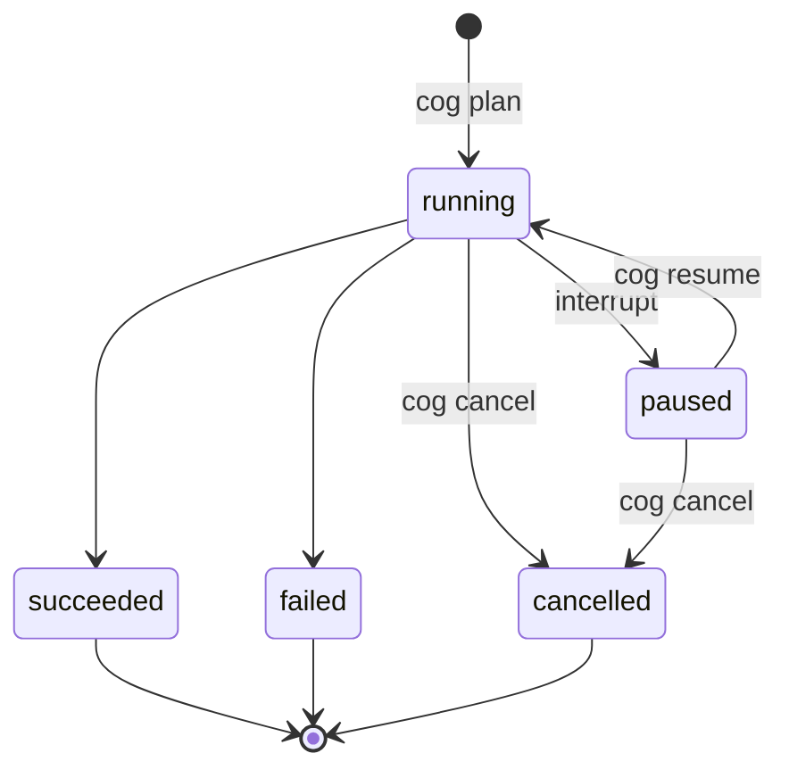
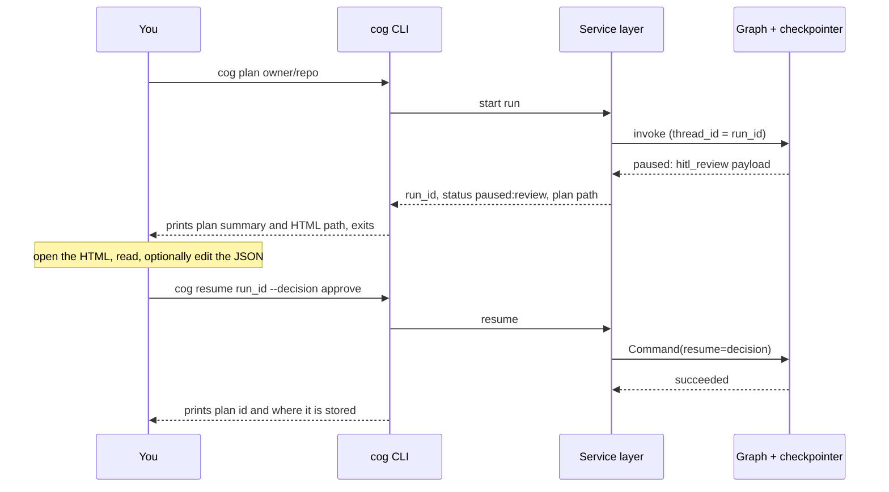

# Interaction Model

**Type:** Explanation · **Status:** Draft v1 · **Last updated:** 2026-10-06

How people use Code-OG: a command-line tool, no chat window. Commands marked _(planned)_ do not exist yet; this page is the specification they will be built against.

---

## 1. Principles

1. **A CLI, not scripts.** Users run `cog`. Workflows are library code behind commands.
2. **Structured pauses, not chat.** A workflow runs until it needs a human, pauses with a clear payload, and waits. The human answers with a command. No conversation is required.
3. **Resumable.** Pauses survive closing the terminal, rebooting, or waiting days. State lives in checkpoints.
4. **Plain terminal.** Works in Git Bash, PowerShell, Windows Terminal, and Unix shells. Uses plain prompts and flags, not a rich TUI, because Git Bash terminals commonly have quirks with interactive programs.
5. **Scriptable.** Every command can run non-interactively with `--json` output and meaningful exit codes.
6. **One service layer.** Anything the CLI does can later be done by a review web page, an MCP server, or a webhook, because they call the same layer.

---

## 2. Commands

| Command                                                      | Purpose                                                                                 |
| ------------------------------------------------------------ | --------------------------------------------------------------------------------------- |
| `cog plan <issue>` _(planned)_                               | Run the Planning workflow on an issue (`owner/repo#123`, or `123` inside a known clone) |
| `cog resume <run_id>` _(planned)_                            | Resume a paused run with a decision or answer                                           |
| `cog runs list` / `cog runs show <run_id>` _(planned)_       | Browse runs, statuses, costs, and events                                                |
| `cog cancel <run_id>` _(planned)_                            | Stop a run at the next safe point                                                       |
| `cog plan export <plan_id>` _(planned)_                      | Write a plan into a target repo (`.cog/plans/`), optionally as a commit or PR           |
| `cog repo add <url-or-path>` / `cog repo list` _(planned)_   | Manage managed clones                                                                   |
| `cog index build <repo>` / `cog index query ...` _(planned)_ | Build and debug the index by hand                                                       |
| `cog config show [--explain]` _(planned)_                    | Show resolved config and which layer set each value                                     |
| `cog doctor` _(planned)_                                     | Check environment and credentials (below)                                               |
| `cog eval run` _(planned)_                                   | Run evaluations, such as the context-recall eval                                        |
| `cog takeover <run_id>` _(planned, Implementation)_          | Open an interactive agent session in a task's worktree                                  |
| `cog gc` _(planned)_                                         | Prune old runs, blobs, indexes, and orphaned worktrees                                  |

Global flags: `--json`, `--non-interactive`, `--offline` (replay from the local mirror), `--config <path>`, `--verbose`.

### `cog doctor`

Checks the things that most often cause confusing failures:

- Python, uv, and git versions; git long-path setting on Windows.
- GitHub token resolution (`GITHUB_TOKEN`, then `gh auth token`) and **remaining API budget** per bucket.
- Each configured provider: key present, endpoint reachable, declared capabilities.
- Each configured runner: binary found, version, shell, and (on request) the live contract test.
- Data directory location, free space, and whether it sits in a cloud-synced folder.
- On Windows: whether `bash` resolves to Git Bash rather than the WSL launcher, where relevant.

---

## 3. Run lifecycle

A run is in exactly one state.

| State             | Meaning                                                     |
| ----------------- | ----------------------------------------------------------- |
| `running`         | Nodes are executing                                         |
| `paused:<reason>` | Waiting for a human (reasons in Section 4)                  |
| `succeeded`       | Finished; outputs persisted                                 |
| `failed`          | Stopped by an unrecoverable fault; details in the event log |
| `cancelled`       | Stopped by `cog cancel`                                     |

---

## 4. Pauses (interrupts)

| Reason                        | Source node (Planning)            | Payload                                       | Valid responses                                                        |
| ----------------------------- | --------------------------------- | --------------------------------------------- | ---------------------------------------------------------------------- |
| `clarify`                     | 14 `ask_human`                    | The question(s) and why they matter           | `--answer "..."`, or `--proceed` to continue with assumptions recorded |
| `review`                      | 21 `hitl_review`                  | Plan id, HTML path, warnings, unresolved gaps | `approve`, `edit` (edited plan JSON), `reject` with feedback           |
| `validation_failed`           | 18 `plan_validator` after retries | Validator errors                              | Edit the plan, give feedback, or abort                                 |
| `budget`                      | any                               | Which cap was reached and the estimate        | Raise the cap, continue, or abort                                      |
| `takeover` _(Implementation)_ | executor escalation               | Task packet and failure summary               | Take over, retry on a higher tier, or abort                            |

Rules:

- Pausing nodes follow the prepare / review / apply pattern so that resuming does not repeat side effects ([LangGraph primer](langgraph-primer.md), Section 5).
- Every pause prints: the run id, the reason, what is needed, and the exact `cog resume` command to run.
- Responses are validated before the run continues; a bad response re-prompts instead of corrupting state.

### The review flow

1. `cog plan` finishes the pipeline and pauses at `review`.
2. It prints a short summary and the path to the **generated HTML** (a view only; see [ADR-0007](../decisions/0007-plans-as-immutable-json.md)).
3. You read it, and you may edit the plan **JSON** (the source of truth).
4. `cog resume <run_id> --decision approve` approves. `--decision edit --file edited.json` submits edits, which are re-derived and re-validated and create a new immutable plan version. `--decision reject --feedback "..."` returns to the planner.

---

## 5. Non-interactive use

- `--non-interactive` makes a pause **exit with a distinct code** instead of prompting. A script can then call `cog resume` later.
- `--json` prints machine-readable status for every command.
- Exit codes distinguish: success, paused (waiting for a human), failure, cancelled, configuration or credential error, and budget breach. Exact numbers are fixed when the CLI is specified in detail.

---

## 6. Output and logging

- Default output is a concise human summary: current node, statuses, warnings, and cost so far.
- `--verbose` streams node events live.
- Everything shown is also in the event store and logs ([Configuration and data](configuration-and-data.md)). `cog runs show` reproduces the full story.

---

## 7. Later interfaces

All call the same service layer, so none changes the workflows.

| Interface                 | Purpose                                         | Notes                                                                           |
| ------------------------- | ----------------------------------------------- | ------------------------------------------------------------------------------- |
| Local web review page     | Richer plan review and editing                  | Must auto-escape all rendered content                                           |
| MCP server                | Let other agents call cog's tools or start runs | Optional                                                                        |
| Webhook / GitHub trigger  | Start runs from issue events                    | Fits scale-up ([ADR-0013](../decisions/0013-scale-seams-not-scale-features.md)) |
| "Ask about this run" chat | Optional convenience                            | Not part of the core model                                                      |

---

## 8. Open questions

- Exact exit-code table and `--json` schema.
- Whether `cog plan` accepts a bare issue number outside a known clone (error, or prompt to choose a repo).
- Default open-in-browser behavior on Windows, macOS, and Linux for the review page.
