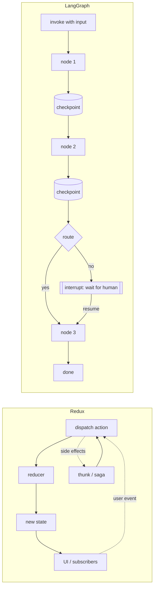
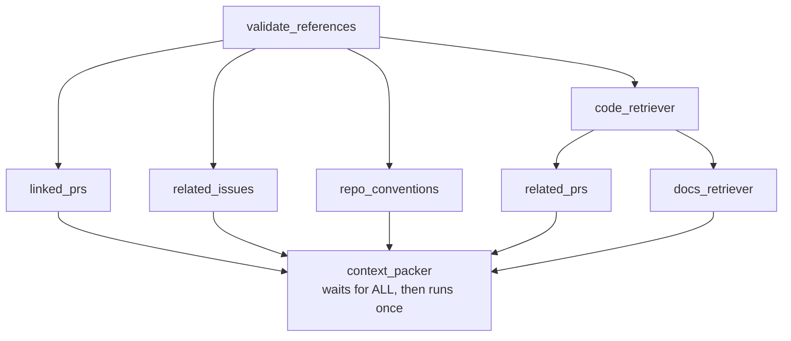

# LangGraph Primer

**Type:** Explanation · **Status:** Draft v1 · **Last updated:** 2026-10-13 · **Audience:** someone new to LangGraph (including readers who know Redux)

This page explains LangGraph well enough to read the Planning workflow reference and to build nodes for it. Items marked **(verify)** depend on library behavior that must be checked against current LangGraph docs before implementation. Code here is illustrative, not project code.

---

## 1. What LangGraph is, and why we use it

LangGraph is a Python library for building **workflows as graphs**. You write ordinary functions (nodes), connect them with edges, and LangGraph runs them while managing three things you would otherwise build yourself:

1. **Shared state** that flows through the run.
2. **Checkpointing**: state is saved after every step, so a run can pause, survive a crash, and resume.
3. **Interrupts**: a node can stop the run and wait for a human, possibly for days, then continue.

It also runs independent nodes **in parallel** and merges their results.

cog uses it because the Planning workflow needs exactly these: parallel retrievers, bounded loops, and human review pauses, with every step inspectable and testable without an LLM. See [ADR-0003](../decisions/0003-langgraph-orchestration-and-state.md).

LangGraph can also run _agents_ where an LLM chooses the next step. cog deliberately uses it as a **workflow engine**: code defines the path, and LLM calls happen inside specific nodes.

---

## 2. Vocabulary

| Term                 | Meaning                                                                              | In cog                                                            |
| -------------------- | ------------------------------------------------------------------------------------ | ----------------------------------------------------------------- |
| **State**            | The typed dictionary flowing through a run                                           | A TypedDict of Pydantic models; big payloads are referenced by id |
| **Node**             | A function that reads state and returns a _partial_ update                           | Every numbered step in the Planning diagram                       |
| **Edge**             | "After A, run B"                                                                     | Static arrows                                                     |
| **Conditional edge** | A routing function picks the next node from state                                    | The yellow diamonds (`sufficient?`, `valid?`)                     |
| **Reducer**          | A per-key merge rule for when several nodes write the same key                       | `operator.add` on `context_items`                                 |
| **Superstep**        | One round: all nodes that are ready run (in parallel), then their updates are merged | The retrievers form one superstep                                 |
| **Checkpointer**     | Saves state at superstep boundaries                                                  | SQLite file in the data directory                                 |
| **Thread**           | The identity of one run's checkpoint history                                         | `thread_id = run_id`                                              |
| **Interrupt**        | A node pauses the run and surfaces a payload                                         | `ask_human`, `hitl_review`                                        |
| **Command**          | How you resume (or redirect) a paused run                                            | `Command(resume=...)`                                             |
| **Subgraph**         | A whole graph used as one node                                                       | Optional packaging for a retriever                                |
| **`Send`**           | Launch a _dynamic_ number of parallel node calls                                     | One lookup per extracted reference                                |
| **Compile**          | Turn the graph definition into a runnable object                                     | Done once per workflow by a factory                               |

---

## 3. Mental model, and how it compares to Redux

If you know Redux, you already have most of the intuition. The comparison is fair as a starting point, but it breaks in three places.

### Where it matches

- **One typed state object** is the shared picture of the world.
- **Updates are partial.** A node returns only the keys it changed.
- **Merge rules** (LangGraph reducers) resemble Redux reducers in spirit: they define how new data combines with existing data.
- **History is inspectable.** Checkpoints work like Redux DevTools time travel, but persisted to disk and usable for replay and resume.

### Where it differs

1. **Control flow lives in the graph.** In Redux, any action can fire at any time and reducers do not decide "what happens next." In LangGraph, edges say exactly what runs next. It is closer to a **state machine (like XState) plus a store**.
2. **Nodes do the work, including I/O.** Redux reducers must be pure, with side effects in thunks or sagas. A LangGraph node is closer to a **thunk and a reducer in one**: it performs I/O and returns a state update. LangGraph's "reducers" are only per-key merge rules.
3. **Nobody dispatches actions.** You _invoke_ the graph with an input. It runs until it finishes or pauses at an interrupt, then returns. Resuming is an explicit act.
4. **Persistence and parallelism are built in.** State survives process exit, and independent nodes run concurrently within a superstep.

| Redux                                        | LangGraph                                                  |
| -------------------------------------------- | ---------------------------------------------------------- |
| Store state                                  | State                                                      |
| Action                                       | Not used; a node's returned update plays a similar role    |
| Reducer `(state, action) → state`            | Per-key reducer (merge rule), and the node function itself |
| Thunk / saga (side effects)                  | The node (does I/O)                                        |
| Middleware / DevTools                        | Checkpointer, event log, LangGraph Studio **(verify)**     |
| "What happens next" is implicit in your code | Edges and conditional edges                                |



A good one-line summary: **a Redux store, a state machine, and a small durable workflow engine combined.**

---

## 4. Anatomy of a run

A run is a series of supersteps:

1. LangGraph starts with the input state and the entry node.
2. It runs every node that is ready. Independent nodes run **in parallel**.
3. Each node returns a **partial update** (a dict of changed keys).
4. LangGraph **merges** the updates into state, using reducers where several nodes wrote the same key.
5. It **saves a checkpoint**.
6. It follows edges (evaluating routing functions for conditional edges) to find the next nodes. Repeat until the end, or until a node interrupts.

### Why reducers matter: the retriever fan-out

In Planning, four retrievers run in parallel and all add to the same list of context items. Without a merge rule, parallel writes to one key conflict. With `Annotated[list[ContextItem], operator.add]`, LangGraph concatenates them.



Notes from the Planning reference that apply here:

- A **list of source nodes** on an edge means "wait for all of them." That is the join.
- `Send` is only for a **dynamic** number of branches. Static fan-out uses ordinary edges.
- Each retriever **catches its own expected failures** and returns a status, so one failure never aborts the run.

### Retrievers share a contract

Every retriever takes the same input (the normalized issue and an index) and returns the same shape: a status (`ok`, `empty`, `skipped`, `error`), a list of candidates, and diagnostics. Because they are interchangeable, you can add, remove, test, and measure each one independently. Package a retriever as a **subgraph** only if it has its own multi-step flow (for example, generate queries, search, then filter). Otherwise a plain function wrapped as a node is enough.

---

## 5. Interrupts and resume

`interrupt(payload)` pauses the run. The checkpointer saves state, and the process can exit entirely. Later you resume the same `thread_id` with a `Command(resume=value)`, and the original `interrupt()` call returns `value`.

```mermaid
sequenceDiagram
  participant U as User (cog CLI)
  participant G as Graph
  participant C as Checkpointer
  U->>G: cog plan 123 (invoke, thread_id = run_id)
  G->>C: checkpoint after each superstep
  G->>G: ... reaches hitl_review
  G-->>U: paused: interrupt payload (plan path, warnings)
  Note over U,G: process may exit; hours or days pass
  U->>G: cog resume run_id --decision approve
  G->>C: load last checkpoint
  G->>G: hitl_review re-runs from its first line
  G-->>U: interrupt() returns the decision; run continues
```

### The gotcha: the node restarts from the top

On resume, **the whole node runs again from its first line**, not from the line after `interrupt()`. **(verify)** Anything before the interrupt runs twice, including an LLM call, a file write, or a GitHub comment.

Rules for cog nodes:

1. Put `interrupt()` **first**, or keep everything before it free of side effects.
2. Better: split into three nodes, **prepare** (does the work), **review** (contains only the interrupt), **apply** (acts on the decision).
3. Interrupts require a checkpointer.
4. Applies to node 14 (`ask_human`) and node 21 (`hitl_review`) in Planning.

---

## 6. How cog uses LangGraph

Conventions, all recorded in [ADR-0003](../decisions/0003-langgraph-orchestration-and-state.md):

- **Version:** LangGraph 1.x, pinned `>=1.1,<2`. The checkpointer ships as a separate package, and the async SQLite variant is used. **(verify)** class names at build time.
- **A node decorator** wraps every node to enforce the node contract: typed inputs and outputs, an explicit failure status for expected conditions, timing and usage logging, and output validation. Do not rely on LangGraph to validate node outputs. **(verify)**
- **Dependency injection:** a graph factory receives a dependencies object (GitHub client, index, stores, provider router, clock). Nodes never import adapters. LangGraph's runtime context may be the delivery mechanism; closures also work. **(verify)**
- **Small state:** big payloads (including retriever results) live in the blob store; state holds ids or hashes. Checkpoints serialize state every step.
- **One durable checkpointer: SQLite.** Every `cog` command is a new process, so pause and resume need state that outlives the process; an in-memory saver cannot do that. The async SQLite saver (`checkpoints.db`) is the only saver cog uses. No file-based or custom saver is planned, and tests that exercise resume use the same SQLite saver against a temporary data directory.
- **Routing functions are pure** (`route_sufficient`, `route_gaps`, `route_validation`, `route_hitl`) and unit-tested directly.
- **Statuses, not exceptions,** for expected conditions such as "nothing found."
- **Bounded loops:** every loop has a limit; see the Planning reference, Section 5. LangGraph's recursion limit is a last-resort backstop, not the design.
- **Retries:** transient provider errors use retry policies at the adapter level. Node-level retries are reserved for idempotent nodes. **(verify)** node retry API.
- **Generated diagram:** the compiled graph can emit Mermaid. A test compares node names against the registry and the draw.io diagram so the picture cannot drift.
- **Optional debugging:** a local Studio or dev server may help visualize runs. **(verify)** whether it is worth the dependency. Hosted tracing is opt-in only ([ADR-0006](../decisions/0006-local-first-storage-no-logging-service.md)).

---

## 7. Common mistakes to avoid

| Mistake                                                             | Why it hurts              | Instead                           |
| ------------------------------------------------------------------- | ------------------------- | --------------------------------- |
| Side effects before `interrupt()`                                   | Runs twice on resume      | Prepare / review / apply split    |
| Parallel writes to one key without a reducer                        | Conflicting updates       | Declare a reducer                 |
| Putting large blobs in state                                        | Slow, bloated checkpoints | Store in blobs, keep ids          |
| Raising exceptions for "no results"                                 | Aborts parallel branches  | Return a status                   |
| Letting an LLM choose loop counts                                   | Unbounded cost            | Fixed limits, escalate to a human |
| Assuming checkpointed models deserialize unchanged after a refactor | Resume breaks             | Round-trip test; version schemas  |

---

## 8. Where to go next

- Walk through the real graph: the Planning workflow reference and diagram.
- How runs are started, paused, and resumed from the terminal: [Interaction model](interaction-model.md).
- Where checkpoints and logs live: [Configuration and data](configuration-and-data.md).
- Terms: [Glossary](../reference/glossary.md).
- The official LangGraph documentation is the authority for API details; confirm every **(verify)** item there.
