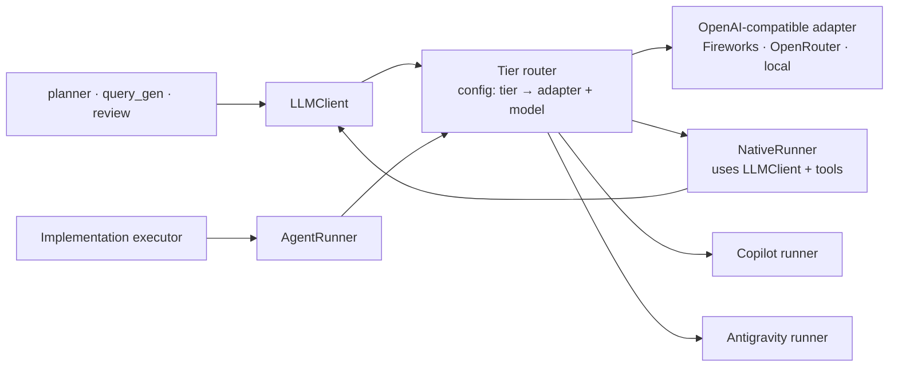

# Providers

**Type:** Explanation · **Status:** Draft v1 · **Last updated:** 2026-10-13
**Diagram:** [`providers.drawio`](../diagrams/providers.drawio)
**Decisions:** [ADR-0004](../decisions/0004-two-provider-interfaces.md), [ADR-0005](../decisions/0005-direct-providers-first.md), [ADR-0011](../decisions/0011-platform-support-and-implementation-execution-environment.md)

Facts about vendors in this page were checked on **2026-10-06** and change quickly. Items marked **(verify)** must be rechecked at build time. Signatures below are illustrative, not project code.

---

## 1. Two kinds of "provider"

|                       | `LLMClient`                                                                                | `AgentRunner`                                                           |
| --------------------- | ------------------------------------------------------------------------------------------ | ----------------------------------------------------------------------- |
| What it is            | A model endpoint: messages in, completion out                                              | An agent product or loop that edits files and runs commands             |
| Who controls the loop | cog                                                                                        | The adapter (its own tools and prompts), or cog if it is `NativeRunner` |
| Used by               | Planner, query generation, plan review, gap resolution                                     | Implementation workflow (executing task packets)                        |
| Needs                 | Structured output, a small read-only tool budget, per-call logging, untrusted text as data | A working directory, a policy, a budget, acceptance results             |
| Examples              | Fireworks, OpenRouter, local servers                                                       | `NativeRunner`, Copilot, Antigravity, Claude                            |

Keeping them separate is what lets Planning keep principle 8 (LLM outputs are proposals, not facts) while Implementation can still use agent products. Planning needs **no** agent CLI.



---

## 2. `LLMClient`

### Contract (illustrative)

> generate(tier, messages, schema=None, tools=None, tool_budget=0, cache_key=None) -> LLMResult

- **Structured output:** when a schema is given, the result is parsed and **validated with Pydantic by cog** whatever the provider enforces. Invalid output enters a bounded repair loop; exhaustion returns a status, not an exception.
- **Tool loop:** tools are read-only, typed functions with a hard call budget (Planning allows at most 8 planner tool calls). Every call is logged.
- **Result:** parsed object or text, `Usage` (input, output, cached tokens; cost, or `None` when unknown, never `0`), the prompt version id, the resolved model, latency, and a status.
- **Defaults:** temperature 0 for extraction and validation-style tasks.

### Adapters

**OpenAI-compatible adapter (first).** One adapter serves Fireworks, OpenRouter, and local servers (Ollama, vLLM). Provider differences are _config_, recorded as quirks:

| Provider                 | Structured output                             | Notes                                                                                                                                                                                                                                                                                                                                                                                                                                                      |
| ------------------------ | --------------------------------------------- | ---------------------------------------------------------------------------------------------------------------------------------------------------------------------------------------------------------------------------------------------------------------------------------------------------------------------------------------------------------------------------------------------------------------------------------------------------------- |
| **Fireworks**            | JSON mode with a JSON schema, or grammar mode | Using a JSON-schema response format disables reasoning output on models that emit it; an older docs page also says the model does not "see" the schema in that mode, so **include the schema in the prompt too**. Function calling enables JSON mode automatically. **(verify per model)**                                                                                                                                                                 |
| **OpenRouter**           | `response_format` of type `json_schema`       | Support is **per endpoint, not just per model**: the same model may be served by several providers, only some supporting structured output. Set `require_parameters: true` in provider preferences so you are never silently routed to an endpoint that ignores your schema. A response-healing plugin exists for non-streaming calls. Provider preferences (ordering, fallbacks, data-collection policy) matter for egress; **(verify)** current options. |
| **Local (Ollama, vLLM)** | Varies by server and model                    | Cheap option for small tiers and query generation.                                                                                                                                                                                                                                                                                                                                                                                                         |

Rules for every provider:

- Capabilities are **declared in config per model** (structured output mode, tool calling, streaming, context window), not assumed. A tier whose model lacks a needed capability fails at `preflight`, not mid-run.
- Always validate and repair.
- Keep per-model-family **prompt overrides**: the same system prompt rarely performs equally across models.

**Other wrappers.**

- `FakeLLM`: returns canned (including deliberately invalid) outputs for tests.
- `RecordReplay`: modes `live`, `record`, `replay`, `cache-only`, keyed by a hash of model, prompt version, rendered messages, and parameters. Powers evals and the node 11 query cache without re-spending tokens.

---

## 3. `AgentRunner`

### Contract (illustrative)

> run(task_packet, workdir, policy, budget, session=None) -> AgentResult
> capabilities: structured_output · sessions · mcp · reports_cost · takeover · native_shell · shell

- **Input:** a task packet from an approved plan, a working directory (a git worktree), the active policy, and a budget.
- **Output:** status (`succeeded`, `failed`, `needs_human`, `budget_exceeded`), the diff and changed files, a transcript reference, usage, and **acceptance results run by cog**, never trusted from the agent's own claims.
- **Policy** is enforced by cog's `ExecutionEnvironment` and tool layer wherever the runner allows, and by sandbox boundaries where it does not.

### Runners

| Runner                                                   | Role                                                                                                                                                                           | Status                                                                                                                                                                                                                                                                                                           |
| -------------------------------------------------------- | ------------------------------------------------------------------------------------------------------------------------------------------------------------------------------ | ---------------------------------------------------------------------------------------------------------------------------------------------------------------------------------------------------------------------------------------------------------------------------------------------------------------- |
| **`NativeRunner`**                                       | cog's own tool-calling loop on `LLMClient`, with tools such as `read_file`, `grep`, `symbol_lookup`, `apply_patch`, and allow-listed `run_command`, all passing through policy | The intended Implementation runner, and a purpose of the project: cog owns the whole loop, with no third-party prompts nested inside its own. The hard parts are reliable edits and context management, which commercial CLIs sell; the other runners are baselines to measure it against. Built after Planning. |
| **Copilot** (SDK or CLI)                                 | Optional runner; also a baseline to compare `NativeRunner` against                                                                                                             | See below                                                                                                                                                                                                                                                                                                        |
| **Antigravity** (SDK or CLI)                             | Optional runner, mainly where models are cheaper through the owner's subscription                                                                                              | See below                                                                                                                                                                                                                                                                                                        |
| **Claude** (API key, or unmodified CLI for personal use) | Optional                                                                                                                                                                       | See terms below                                                                                                                                                                                                                                                                                                  |
| **`FakeRunner`**                                         | Tests                                                                                                                                                                          | Planned                                                                                                                                                                                                                                                                                                          |

### Copilot

- A Copilot SDK became generally available on 2026-06-02, with Python among the supported languages, and the Python package bundles the CLI. **(verify)** current status and package names.
- The CLI has non-interactive (`-p`) and interactive (`-i`) modes. Non-interactive use requires an allow-all permissions setting, which makes the sandbox mandatory.
- **BYOK** lets the CLI use your own provider through environment variables: `COPILOT_PROVIDER_BASE_URL`, `COPILOT_PROVIDER_API_KEY` (optional for some local setups), and `COPILOT_PROVIDER_TYPE` (`openai`, the default, `azure`, or `anthropic`). OpenAI-compatible endpoints, including Ollama and vLLM, are supported.
- **BYOK value:** it gives you Copilot's agent loop (editing, shell, permissions, sessions) paid per token to Fireworks or OpenRouter. It is the **fastest stopgap for Implementation** while `NativeRunner` matures, and a baseline for comparison. It adds nothing to Planning.
- **BYOK costs:** the model must support tool calling and streaming; `--effort` is rejected for custom models; the CLI cannot send custom request headers; you do not control its system prompt or tools, so Planning's tool-budget and logging rules cannot apply inside it; and it is a moving target (pin versions). Whether BYOK mode still requires a GitHub login is unclear in the sources: **(verify by testing on the owner's account)**.
- **Windows:** works interactively from Git Bash for the owner. Unattended runs need verification; see [ADR-0011](../decisions/0011-platform-support-and-implementation-execution-environment.md).

### Antigravity

- The owner holds an Antigravity subscription and no other agent subscription.
- Google's docs describe an `agy` CLI with a headless mode for CI and scheduled automation, and a separate Python SDK (`google-antigravity`) with structured output, policies, hooks, MCP, subagents, and persistence. The SDK authenticates with a Gemini API key or Vertex, **not** the subscription. **(verify)**
- The CLI uses interactive sign-in and subscription quotas. Plans differ in model access: all plans include Gemini models, and third-party models are listed under the Ultra tier, so check the current Models page for the owner's tier. **(verify)**
- A public forum thread asks Google whether orchestrating the official CLI headlessly from a third-party multi-agent app is permitted under the terms. **No official answer** was found in the sources read. Treat subscription-backed automation as unconfirmed.
- The `agy` CLI replaced Gemini CLI for individual developers in mid-2026, a reminder that flags and tools churn.

### Claude and terms of use

Anthropic's Claude Code documentation says subscription sign-in is for ordinary use of Claude Code and native apps, developers building products or services (including with the Agent SDK) should use API keys, and routing requests through Free, Pro, or Max credentials on behalf of users is not permitted. A planned credit change for `claude -p` and Agent SDK usage was paused in June 2026. Terms have changed repeatedly; **read the current text before relying on anything here**.

### Rules for every subscription-backed runner

1. cog **never extracts or reuses subscription tokens** to call vendor APIs. It uses an official SDK, shells out to the unmodified official CLI, or uses an API key.
2. Credentials are environment variables (or the CLI's own login). cog never stores a subscription credential.
3. Each runner has a **live contract test** (`tests/live/`, skipped by default) run on the owner's machine: does an unattended run behave like an interactive one, with the intended shell, permission mode, and output format?
4. Pin CLI versions. Record the version in the run record.
5. Results are normalized into `AgentResult`. Unknown usage is `None`.
6. A subscription runner may be disabled by config at any time without code changes.

### Takeover

For human escalation, `cog takeover <run_id>` can open an interactive session in the task's worktree seeded with the task packet (for Copilot, using its interactive mode). Runners declare `takeover` in their capabilities. This is a fallback when the escalation ladder is exhausted, not a chat interface. Antigravity's equivalent is unverified.

---

## 4. Tiers and the escalation ladder

Config maps tiers to `(adapter, model)` pairs. Plans refer to tiers by name (`executor_tier`). The **escalation ladder** is the ordered list a failed task climbs before a human is involved.

```toml
# illustrative user config
[providers.fireworks]
kind = "openai_compat"
base_url = "https://api.fireworks.ai/inference/v1"
key_env = "FIREWORKS_API_KEY"

[providers.openrouter]
kind = "openai_compat"
base_url = "https://openrouter.ai/api/v1"
key_env = "OPENROUTER_API_KEY"
quirks = { require_parameters = true }

[tiers.small]
adapter = "fireworks"
model = "..."
[tiers.large]
adapter = "openrouter"
model = "..."

[escalation]
ladder = ["small", "medium", "large"]
```

Workflows do not name tiers directly for completions. They request a **role**, and config resolves role → tier → `(adapter, model)`:

| Role        | Used by (Planning) | Default tier                                                                               |
| ----------- | ------------------ | ------------------------------------------------------------------------------------------ |
| `planner`   | Node 15            | large                                                                                      |
| `query_gen` | Node 11 (optional) | small                                                                                      |
| `verdict`   | Node 13 (optional) | small                                                                                      |
| `reviewer`  | Node 19 (optional) | medium, or an explicit different model; config warns if it resolves to the planner's model |

`preflight` (node 1) validates that each role's tier exists, is reachable, and has the required capabilities.

---

## 5. Errors

Adapters classify failures so callers can react correctly.

| Class                 | Typical cause                                                | Default reaction                                      |
| --------------------- | ------------------------------------------------------------ | ----------------------------------------------------- |
| `AuthError`           | Missing or invalid key or login                              | Stop; tell the user which variable or login           |
| `RateLimited`         | HTTP 429 with a retry hint                                   | Back off, retry within budget                         |
| `QuotaExceeded`       | Subscription or credit exhausted, possibly with a reset time | Stop or fall back to another tier; surface reset time |
| `Timeout`             | Slow call or hung process                                    | Retry once; kill the process tree                     |
| `MalformedOutput`     | Output fails schema validation                               | Repair loop, then status                              |
| `ContentFiltered`     | Provider refusal                                             | Surface; do not retry blindly                         |
| `ProviderUnavailable` | 5xx or network                                               | Retry with backoff, then fall back                    |
| `CapabilityMissing`   | Tier lacks a required feature                                | Fail at `preflight`                                   |

---

## 6. Budgets and cost control

- **Per-run and per-node caps** on tokens and dollars, set in config with conservative defaults.
- **Estimate before long runs** (Implementation especially) and show it for confirmation.
- **Kill switch:** `cog cancel <run_id>` stops at the next safe point.
- **Accounting:** every call records usage and, where known, cost into the event store. Unknown cost is `None`, and the run report says so. Prices come from a config table, not from memory.
- A budget breach is an **interrupt** (the human decides), not a silent stop.

---

## 7. Prompts

- Prompts are **files**, not strings in code, stored with each workflow and **versioned**. The prompt version id is recorded in every run record.
- Templates are rendered with a small, auto-escaping templating step. A single helper wraps **untrusted text** (issue bodies, comments, docs, code) in clear delimiters, and prompts state that delimited content is data, not instructions.
- **Per-model overrides** are allowed and explicit.
- **Neutrality:** prompts contain no code-style preferences. Any default is labeled overridable. Reviews of prompt changes check for smuggled style opinions ([ADR-0014](../decisions/0014-repo-convention-precedence.md)).
- Prompt changes are treated like code changes: snapshot-tested, and evaluated before merge when they affect recall or planning quality.

---

## 8. Data egress and secrets

- A policy decides which repos may be sent to which provider (for example, private repos only to approved providers).
- Context packs are scanned and **secrets redacted** before leaving the machine.
- OpenRouter provider preferences may restrict routing to providers with acceptable data policies. **(verify)**
- Keys never appear in config files, logs, or run records. Logs pass through a redaction filter.

---

## 9. Verification list for this page

| Item                                                        | Check                                     |
| ----------------------------------------------------------- | ----------------------------------------- |
| Copilot SDK status, package names, Python version support   | Vendor docs                               |
| Copilot BYOK login requirement                              | Test on the owner's account               |
| Copilot unattended use from Git Bash on Windows             | Live contract test                        |
| Antigravity headless flags and output format                | Vendor docs and a live test               |
| Antigravity subscription terms for automation               | Vendor statement; not currently available |
| Antigravity plan model access for the owner's tier          | Models page                               |
| Fireworks structured-output behavior per model              | Test each chosen model                    |
| OpenRouter provider preferences and data-collection options | Vendor docs                               |
| Anthropic terms (if a Claude runner is ever used)           | Current legal page                        |
