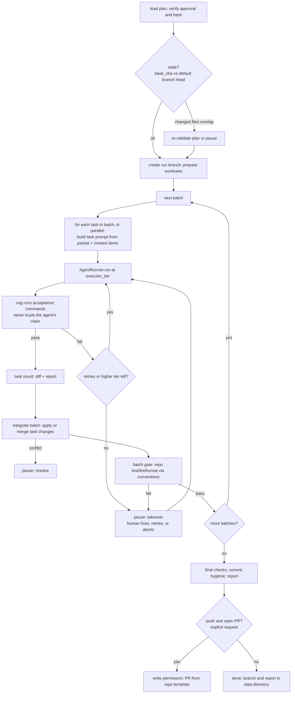

# Implementation Workflow — Outline

**Type:** Workflow outline · **Status:** Draft, scoped outline only · **Last updated:** 2026-10-06

This is **not a design.** It records what is known, what Planning already guarantees, and the questions to answer when Implementation is designed (Phase 6, documentation first). Nothing here is a commitment. Items marked **(verify)** are tracked in the [roadmap's verification log](../../roadmap.md#verification-log).

---

## 1. Purpose

Execute an **approved plan**, task by task, producing a branch (and, on request, a pull request) with changes that pass the plan's acceptance checks, using the repo's own conventions and tools. Every step is logged, bounded, and sandboxed, with humans pulled in at defined points.

It is the second workflow on the same runtime: same `cog` CLI, same state and event store, same policy, with `AgentRunner` as its provider interface ([ADR-0004](../../decisions/0004-two-provider-interfaces.md)).

---

## 2. What Planning hands over

The handoff artifact is the approved plan directory ([ADR-0007](../../decisions/0007-plans-as-immutable-json.md)):

- `plan.json`: validated tasks with `depends_on`, `files_to_modify`, `files_to_create`, `context_refs`, `acceptance` commands, `stop_conditions`, and `executor_tier`, plus code-derived `batches`, assumptions, and the traceability from requirements to tasks;
- `base_sha` and the plan's hash;
- `approval.json`: who approved which hash, when, and with what edits;
- a pointer to the stored **context snapshot** (so the executor sees what the planner saw);
- the resolved config and policy snapshot used to produce it.

**Requirements Implementation places on Planning** (to hold in Planning v3 and later versions): every task has resolvable acceptance commands; file lists are validated against `base_sha`; stop conditions are explicit; tiers use the shared tier names; and the plan hash is verified before execution.

---

## 3. Sketch of the flow (tentative)

Tentative node areas: plan loading and verification, staleness check, workspace preparation, batch loop, task execution with escalation, acceptance runner, integration, batch gate, finalization, reporting.

---

## 4. Principles carried over

- **Deterministic where checkable.** Acceptance is run by cog, not asserted by an agent.
- **Everything bounded:** tokens, dollars, time, retries, tiers climbed, parallelism.
- **Status, not exceptions;** pauses with explicit reasons (`takeover`, `budget`, `merge_conflict`, `validation_failed`).
- **Repo conventions outrank harness preferences:** commit messages, branch names, formatting, and PR descriptions follow the repo's own rules and templates ([ADR-0014](../../decisions/0014-repo-convention-precedence.md)).
- **No footprint without request:** nothing is pushed or opened as a PR unless asked.
- **Sandboxed:** all execution through `ExecutionEnvironment`, with task allow-lists, command allow-lists, and scrubbed environments ([Policy and sandbox](../../explanation/policy-and-sandbox.md)).

---

## 5. What the foundation already provides

| Need                        | Provided by                                                           |
| --------------------------- | --------------------------------------------------------------------- |
| Resumable, inspectable runs | LangGraph checkpoints, event store                                    |
| Human pauses and the CLI    | Interaction model (`resume`, `takeover`, `cancel`)                    |
| Model and agent access      | `AgentRunner`, tiers, escalation ladder, adapters                     |
| Containment                 | `ExecutionEnvironment` (WSL2 or containers expected), policy snapshot |
| Cost control                | Budgets, estimates before long runs                                   |
| Evidence                    | Event store, blobs, transcripts                                       |

---

## 6. Questions to answer in the design

**Execution environment** ([ADR-0011](../../decisions/0011-platform-support-and-implementation-execution-environment.md))

- Does cog run entirely inside WSL2, or on Windows dispatching into it? Where do managed clones and worktrees live? One data directory per environment, or shared?
- Which sandbox tier is the minimum for unattended runs, and how is the network profile per command enforced?

**Agent runners**

- `NativeRunner` design: edit format (unified diff, search-and-replace blocks, whole-file), tool set, context management, loop bounds, and how it recovers from failed edits.
- Copilot BYOK as a stopgap and baseline: its contract test results decide how much to rely on it.
- How each runner receives the task packet and policy, and how its transcript and usage are normalized.

**Workspace and integration**

- Worktree lifecycle, naming, reset between retries, and cleanup after crashes (`cog gc`).
- How parallel task changes combine: sequential application in dependency order, per-task branches merged, or patches applied to one worktree; and how conflicts are detected and surfaced.
- One commit per task, per batch, or one in total, constrained by the repo's conventions.

**Acceptance and escalation**

- Command semantics: working directory, timeouts, flaky tests, partial passes, tests that need services.
- The escalation ladder: when to retry the same tier versus climb, and how failure evidence is passed to the next attempt.
- Stop conditions in the packet: how they are checked and what they trigger.

**GitHub write path**

- Branch naming, PR templates, linking the issue, what plan summary or trace goes in the description.
- Write-scoped authentication, separate from the read-only token used by Planning; a GitHub App as the scale-up route.

**Staleness and drift**

- What counts as "plan is stale," and whether to re-run Planning's validation automatically.

**Safety**

- Prompt-injection exposure now that agents edit files; which files an agent may read beyond its task list.
- Secret handling in transcripts and diffs.

**Cost**

- Estimating cost before starting; pausing when the estimate exceeds the cap.

---

## 7. Non-goals for v1

No automatic merging, no deployment, no changes across multiple repos in one run, no editing of CI definitions, and no unattended pushes.

---

## 8. Evaluation (to be designed)

Metrics noted in [Testing and evaluation](../../explanation/testing-and-evaluation.md): first-pass task success per runner and tier, escalation rate, batch conflict rate, acceptance flakiness, time, and cost. Fixture repos with scripted tasks and a `FakeRunner` cover the logic; live contract tests cover real runners.

---

## 9. Plan for the design phase

1. Review Planning's output contract against Section 2; amend Planning if needed.
2. Write the Implementation reference and diagram in the same format as Planning v3.
3. Decide the execution environment and record the outcome in ADR-0011.
4. Specify the `AgentRunner` and `NativeRunner` contracts, and the live contract tests.
5. Add the outline's open questions to the verification log or resolve them in ADRs.
